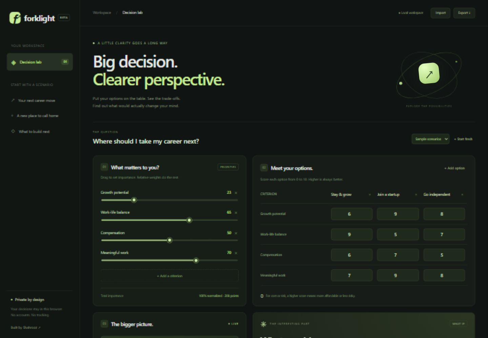

# Forklight ↗

**Make the trade-offs visible.**

A small, local-first decision sandbox. Compare options, tune priorities, and find out what would change your mind. Written in plain JavaScript, HTML, and CSS. No build tools, accounts, API keys, tracking, or third-party assets.



## What it does

- Compare 2–5 options against 1–8 criteria.
- Adjust importance sliders and see normalized weighted scores immediately.
- Find tipping points: the smallest integer change to each individual weight that produces a different strict winner.
- Try a tipping-point scenario with one click.
- Start from three illustrative scenarios: career, moving, or product ideas.
- Save in this browser, export/import a validated JSON decision, or download a text report.
- Works offline after downloading the files. English UI, responsive layout, keyboard-accessible controls.

## Run

Open `index.html` in a modern browser, or serve this directory:

```sh
python -m http.server 4180
```

Visit `http://localhost:4180`. There are no dependencies to install. Browser storage on `file://` differs by browser; export JSON if storage is unavailable.

## Test

Node.js 18+:

```sh
npm test
```

## How the math works

Each score is between 0 and 10, where higher always means better. The result is `sum(weight × score) / sum(weights)`. For cost and risk, use affordability and safety scores rather than raw prices or risks. Weights are relative points, not percentages; the app normalizes them. When all weights are zero, there is no meaningful ranking. Exact ties are explicitly marked.

Sensitivity checks change one weight at a time across integers 0–100, leaving every other input fixed. It finds strict winner changes, not mere ties. A resilient lead only refers to this bounded search, not certainty or multi-variable robustness. These subjective inputs are a thinking aid, not financial, medical, or other professional advice. Sample scores are invented examples, not recommendations.

## Privacy & storage

Decision data stays in `localStorage` on your device. The app makes no network requests with your inputs. Export files contain the full decision and scores; share them intentionally. “Clear saved data” removes the stored workspace and pauses saving for the current session. Importing, starting fresh, or loading a scenario enables saving again. The host may receive normal page requests, but not the decision text.

## Structure

- `engine.js`: pure ranking, sensitivity, and import-validation functions
- `app.js`: UI, persistence, and file export/import
- `engine.test.js`: ranking, tipping points, zero weights, ties, and import-validation tests

## Author

[Shahrooz](https://github.com/shahrouoz) — Computer Engineer & Product Builder

No open-source license has been granted yet. GitHub's terms still apply to public viewing and forking.
